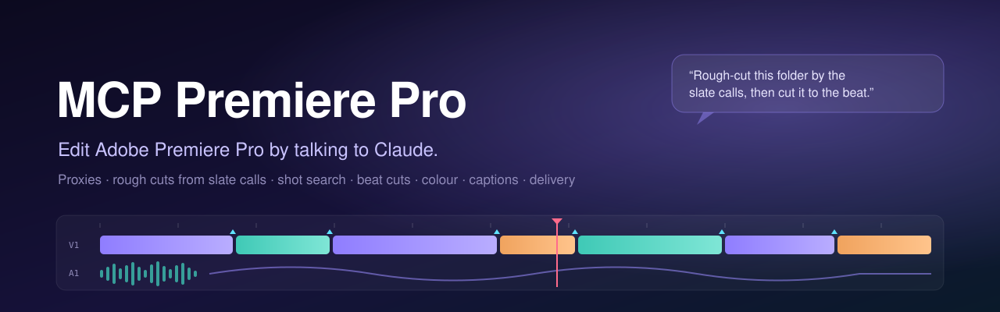
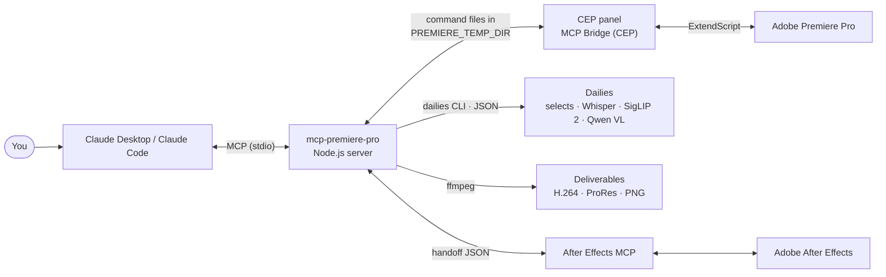

<div align="center">



<br>

[](LICENSE.md)
[](https://nodejs.org/)
[](#requirements)
[](#requirements)
[](https://modelcontextprotocol.io/)

**A Model Context Protocol server that lets Claude edit in Adobe Premiere Pro the way a working editor does.**

[Features](#features) · [How it works](#how-it-works) · [Quick start](#quick-start) · [Try it](#try-it) · [Studio tools](#studio-tools) · [Safety](#safety) · [Roadmap](#roadmap)

</div>

---

MCP Premiere Pro connects Claude (Desktop or Code) to a running copy of Premiere Pro through a small CEP panel. On top of ~280 low-level tools for projects, bins, sequences, clips, effects, keyframes, markers and exports, it adds a set of **studio tools** built around a real commercial editing workflow: proxies first, a rough cut assembled from the slate calls heard on set, shot search by plain words, music-driven cuts, per-scene colour, captions, aspect versions, a round trip to After Effects, and delivery exports with fixed, tested settings.

Everything runs on your own Mac. Footage never leaves the machine; heavy analysis (speech, vision, beats, loudness) is done locally by a companion footage engine, Dailies.

## Features

| Area | What you get | Tools |
|---|---|---|
| **Proxy-first workflow** | Half- or quarter-res ProRes Proxy made with the Mac hardware encoder, one file at a time at low priority, attached to the clips automatically. Analysis reads the proxies too. | `create_proxies`, `proxy_status` |
| **Cue-based rough cut** | Whisper listens to each file's own audio for slate calls (`3-2-1`, `action` … `cut`, `ok`; English, Vietnamese and more) and lays every take back to back in a new sequence, with a marker per take and red markers on low-confidence ones. | `rough_cut_by_cues` |
| **Footage inspection** | You create the sequence and import the footage; this reads every clip's properties (size after rotation and pixel aspect, shooting frame rate, in-camera slow motion and time-lapse, log such as S-Log3 from the camera's own metadata, VFR) and checks them against your sequence: every clip that is not its size is fit to frame. The rough-cut and selects tools build an empty copy of your sequence (same settings) and fit every clip to it. | `inspect_footage` |
| **Footage selects** | Scores b-roll and general footage about 4 times a second (sharpness on a grid, exposure, camera move, shake) and keeps the usable stretches: a selects sequence with a marker per segment, plus FCP7 XML, FCPXML, EDL and CSV for another editor. An hour of 4K in about 2 minutes. | `inspect_footage` | Read clip properties and check them against your sequence (fit to frame); flags log, slow motion, time-lapse, judder, VFR. |
| `score_footage` |
| **Best-take scoring** | Ranks takes by how they ended, cue confidence, how clearly the lines were spoken and retake calls ("again", "otra vez"…), with reasons; can build a selects sequence. | `select_best_takes` |
| **Shot description** | One-line description, shot size, setting, sharpness, exposure, shake and faces for every clip, written into the Project panel so you can search and sort. | `describe_sources` |
| **Shot search by text** | Type what you want to see ("close-up of a face", "wide shot of the restaurant") in English or Vietnamese. SigLIP 2 compares every second of each proxy with the words; hits come back ranked with in/out, as markers on the source clips and optionally as a "Tìm: …" sequence. | `find_shots` |
| **Music beats** | Tempo, every beat and the first beat of each bar, dropped as markers on the timeline. | `detect_beats` |
| **Cut to the beat** | A copy of the sequence where every cut lands on the nearest beat (every beat, every other, or every bar). Motion is carried over; the original is untouched. | `cut_to_beats` |
| **Voiceover ducking** | Places a VO on a free track and ducks the music only where the voice actually speaks, with editable Volume keyframes. | `place_voiceover`, `setup_ducking` |
| **Loudness** | Measures every clip in LUFS (only the part used) and sets dialogue and music to their targets, keeping ducking shapes. | `normalize_loudness` |
| **Captions from speech** | Reuses the words already heard during the rough cut, cut to each clip's in/out, written to SRT and added as a caption track. | `transcribe_to_captions` |
| **Per-scene colour** | One Lumetri adjustment layer per source ("Màu &lt;source&gt;"); repeated sources share a name and identical values. Grade one, then sync all its instances. | `add_scene_color_layers`, `sync_color_layers`, `add_color_layer` |
| **Aspect versions** | Square, vertical or 4:5 copies of a finished horizontal edit, each clip re-framed from the horizontal frame (face-aware, never showing black edges). | `create_aspect_versions` |
| **Film Impact transitions** | The Film Impact set built into Premiere 2026 (Light Leak, Whip, Push, Flash, Zoom Blur, Glitch…) applied by name, with a knowledge note on when to use which. | `batch_add_transitions`, `add_transition`, `pr_guide` |
| **After Effects round trip** | Send one clip to the [After Effects MCP](https://github.com/Miinwan/mcp-after-effects) as a matching comp, then lay the render back above the original (the original is only disabled). | `send_to_after_effects`, `return_from_after_effects` |
| **Export presets** | ProRes 422 HQ master from Premiere, then every deliverable via ffmpeg: H.264 High VBR (Full HD 50 Mbps, 4K 20 Mbps), capped at 1 GB, QT Gamma Compensation LUT, −14 LUFS, consistent file names and an export log. | `export_deliverables`, `export_status` |
| **Review cut + QC** | An editor's pass before showing a cut (pacing, flash frames, jump cuts, footage used twice, off-beat cuts, contact sheet) and a pre-delivery check (offline media, gaps, leftovers, proxies still on, wrong frame). | `review_cut`, `qc_before_export`, `mako` |
| **Project clean-up** | After delivery, review what the job no longer uses, then remove it from the project and move the files (and their proxies) to the macOS Trash — never a hard delete. | `review_unused_media`, `clean_unused_media` |
| **Housekeeping** | Labelled `.prproj` checkpoints before big changes, tidy numbered bins, solid colour plates without Premiere's blocking colour picker. | `checkpoint_project`, `organize_project_bins`, `add_color_matte` |

## How it works



- **Server** (`src/`): a TypeScript MCP server. Low-level tools live in `src/tools/index.ts`, `expanded.ts` and `color.ts`; the studio workflow lives in `src/tools/studio.ts`, `beats.ts`, `cleanup.ts` and `deliverables.ts`.
- **CEP panel** (`cep-plugin/`): runs inside Premiere, picks up command files from the bridge folder and executes them as ExtendScript. It loads with Premiere and starts the bridge on its own.
- **Dailies** ([Miinwan/dailies](https://github.com/Miinwan/dailies)): a separate local Python CLI that scores footage and picks selects, does speech-to-text, shot description, text-to-shot search and framing on proxies, and caches its results in a `.dailies/` folder next to the footage.
- **Knowledge base** (`Kiến thức/`): Markdown notes on transitions, colour, plugins, exports and clean-up that the `pr_guide` tool reads at run time. Drop in a new `.md` and it is available without a rebuild.

## Quick start

### Requirements

- macOS (developed on Apple Silicon)
- Adobe Premiere Pro 2026 (26.x; tested on 26.5)
- Node.js 20 or newer
- [ffmpeg](https://ffmpeg.org/) on the `PATH` or in Homebrew's location (exports, beats, loudness)
- Optional: Dailies, the footage engine (Python, run with [uv](https://docs.astral.sh/uv/)) for cue-based cuts, shot description and shot search; the After Effects MCP for the AE round trip

### 1. Install and build

```bash
git clone https://github.com/Miinwan/mcp-premiere-pro.git
cd mcp-premiere-pro
npm install
npm run build
```

### 2. Install the CEP panel

```bash
npm run setup:mac
```

This copies the panel to `~/Library/Application Support/Adobe/CEP/extensions/MCPBridgeCEP`, turns on Adobe's `PlayerDebugMode` (needed for unsigned panels) and adds a `premiere-pro` entry to the Claude Desktop config. Check the result with `npm run setup:doctor`.

Restart Premiere Pro and open **Window → Extensions → MCP Bridge (CEP)** once. From then on it loads with Premiere and starts the bridge automatically (set `"autoStart": false` in `~/.premiere-mcp-bridge/config.json` to turn that off).

### 3. Connect Claude

If you skipped the installer, or use a different client, add the server by hand. For Claude Desktop, edit `~/Library/Application Support/Claude/claude_desktop_config.json`:

```json
{
  "mcpServers": {
    "premiere-pro": {
      "command": "/path/to/node",
      "args": ["/path/to/mcp-premiere-pro/dist/index.js"],
      "env": {
        "PREMIERE_TEMP_DIR": "/tmp/premiere-mcp-bridge",
        "DAILIES_DIR": "/path/to/dailies"
      }
    }
  }
}
```

For Claude Code:

```bash
claude mcp add premiere-pro --env PREMIERE_TEMP_DIR=/tmp/premiere-mcp-bridge -- node /path/to/mcp-premiere-pro/dist/index.js
```

Restart the client, then ask: *"Run `verify_premiere_connection` and make no changes."*

### Optional settings

| Variable | What it points to |
|---|---|
| `PREMIERE_TEMP_DIR` | Bridge folder shared with the CEP panel (default `/tmp/premiere-mcp-bridge`) |
| `DAILIES_DIR` | Folder of the Dailies CLI (`MEDIA_DIR` still read) |
| `UV_PATH` | `uv` binary, if it is not in `~/.local/bin` or Homebrew |
| `FFMPEG_PATH` | `ffmpeg` binary, if it is not in Homebrew's location |
| `MCP_ADOBE_BRIDGE_DIR` | Handoff folder shared with the After Effects MCP |
| `PR_GUIDE_DIR` | Knowledge-base folder read by `pr_guide` |
| `MCP_QT_GAMMA_LUT` | The QT Gamma Compensation `.cube` applied to H.264 deliverables |
| `PR_MASTER_EPR` | Media Encoder preset used for the ProRes master |

## Try it

Plain sentences work; Claude picks the tools.

> Make proxies for `/path/to/Footage/Day 1`, then rough-cut it by the slate calls into a 1920×1080 sequence.

> Rank the takes in this bin and build a selects sequence with the best one per file.

> Find shots of "a waiter pouring wine" and put the top 8 on a new sequence.

> Detect the beats of the music on A2 and make a copy of the cut where every cut lands on every second beat.

> Put `voiceover.wav` at the playhead and duck the music under it, then normalise the loudness.

> Add one colour layer per scene, I'll grade the first one; then sync the others.

> Make 1:1 and 9:16 versions of "Final 16x9", then export YouTube 1080, Reels and a review copy for client "Studio", title "Summer Menu".

> Review the cut for a 30-second target and run QC before export.

> The job is delivered — show me what's unused before cleaning up.

## Studio tools

The 28 tools added on top of the base Premiere tool set (`studioToolNames` in [`src/tools/studio.ts`](src/tools/studio.ts)):

| Tool | What it does |
|---|---|
| `create_proxies` | First step of a job: ProRes Proxy (or H.264) at 1/2 or 1/4 resolution with VideoToolbox, saved in `<footage>/Proxies/`, attached to the clips. Runs in the background. |
| `proxy_status` | Progress of a `create_proxies` job. |
| `checkpoint_project` | Save, then keep a labelled copy of the `.prproj` before a large automated change; list existing checkpoints. |
| `organize_project_bins` | Move loose root items into numbered bins (Footage, Audio, Graphics, Sequences, Adjustment, Proxies & renders). Never deletes or renames. |
| `rough_cut_by_cues` | Rough-cut footage by the slate calls heard in each file; new sequence, markers per take, low-confidence takes in red. |
| `describe_sources` | Describe every shot (description, shot size, quality numbers) and write it into the Project panel's Comment and Log Note columns. |
| `find_shots` | Find shots by words (English or Vietnamese) with SigLIP 2; ranked hits with in/out, markers on source clips, optional "Tìm: &lt;query&gt;" sequence. |
| `score_footage` | Score footage and keep the usable stretches; selects sequence and XML/FCPXML/EDL/CSV export for another editor. |
| `select_best_takes` | Rank takes with reasons; optionally build a selects sequence. |
| `detect_beats` | Tempo, beats and bar starts of the music, with timeline markers. |
| `cut_to_beats` | Copy of the sequence with every cut moved onto the beat. |
| `place_voiceover` | Place a voiceover and duck the music only where the voice speaks. |
| `normalize_loudness` | Measure each clip in LUFS and set dialogue/music levels. |
| `transcribe_to_captions` | Captions from the words already heard, as SRT plus a caption track. |
| `add_scene_color_layers` | One Lumetri adjustment layer per source on a new top track. |
| `sync_color_layers` | Copy every Lumetri parameter from one scene layer to the others with the same name. |
| `add_color_layer` | One colour layer over the whole sequence or a range (a global look). |
| `add_color_matte` | Solid white, black or `#RRGGBB` plate at sequence size, without Premiere's colour picker. |
| `create_aspect_versions` | Square / vertical / 4:5 copies of a horizontal edit, re-framed clip by clip. |
| `mako` | Drive the Mako panel: adjustment layers, staircase, freeze frame, fit/fill, nest/unnest, QC markers and more. |
| `send_to_after_effects` | Record a timeline clip in a handoff file for the After Effects MCP. |
| `return_from_after_effects` | Lay the After Effects render back on the timeline above the original. |
| `pr_guide` | Read the knowledge base: transitions, plugins, colour, exports, clean-up. |
| `review_cut` | Editor's review of a cut with "Review:" markers and a contact sheet. |
| `qc_before_export` | Read-only pre-delivery check with timecodes. |
| `export_deliverables` | ProRes master, then every requested deliverable with fixed presets, names and loudness. |
| `export_status` | Progress of an export job, with files and measured LUFS. |
| `review_unused_media` | Read-only report of unused project items and files after delivery. |
| `clean_unused_media` | Act on that report after you approve it: checkpoint, remove from the project, move files to the Trash. |

All the base tools (`get_project_info`, `list_sequences`, `add_to_timeline`, `apply_effect`, `set_lumetri_basic`, `export_frame`…) remain available; ask Claude to call `get_capabilities` for the full list.

## Safety

- **Non-destructive by default.** Rough cuts, beat cuts, selects and aspect versions are built as new sequences; the AE round trip only disables the original clip.
- **Checkpoints.** `checkpoint_project` saves a copy of the project before large changes; `clean_unused_media` takes one automatically.
- **Nothing is deleted for good.** Clean-up only moves files inside the job folder to the macOS Trash (Put Back works), only after `confirm: true`, and re-checks usage right before acting.
- **Local only.** The server, panel and Dailies run on your machine. Nothing is uploaded.
- **Trust.** Any MCP client connected to this server can edit the open project. Use it only with clients you trust. See [SECURITY.md](SECURITY.md).

## Roadmap

- [x] Proxy-first workflow, cue-based rough cut, take ranking
- [x] Shot description and text-to-shot search
- [x] Beats, cut to beats, voiceover ducking, loudness
- [x] Per-scene colour layers, aspect versions, After Effects round trip
- [x] Delivery presets, review cut, QC, project clean-up
- [ ] Knowledge base with sub-folders in `pr_guide`
- [ ] Silence removal driven by Dailies
- [ ] Windows support for the studio tools

## Credits

The low-level Premiere tool set and the CEP bridge started from an open-source MIT project; see [LICENSE.md](LICENSE.md) for the original copyright notice. Film Impact, Mako, Lumetri, Premiere Pro and After Effects are trademarks of their respective owners.

## License

[MIT](LICENSE.md)
